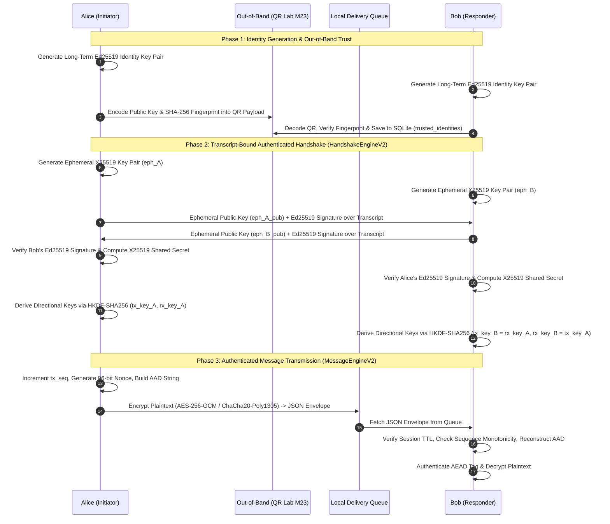
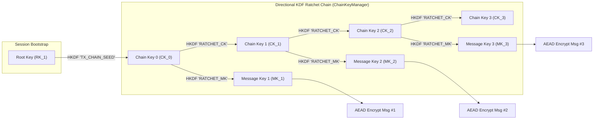
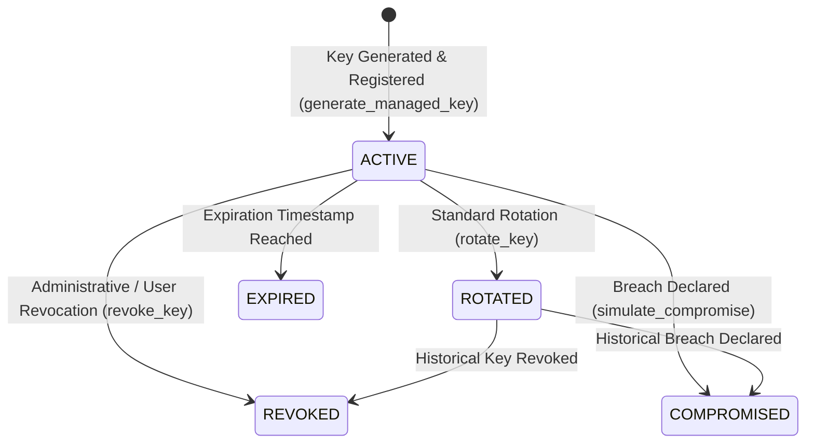
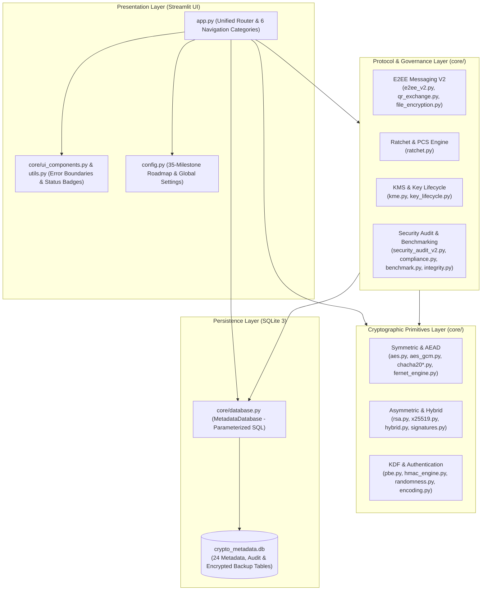

# 🛡️ Cryptography-Based Secure Messaging Laboratory

**A Modular, Research-Oriented Educational Laboratory for Applied Cryptography, End-to-End Encrypted Messaging, Cryptographic Ratcheting, Key Lifecycle Governance, and Security Auditing.**


---

## 2. Table of Contents

1. [Project Title, Tagline & Badges](#-cryptography-based-secure-messaging-laboratory)
2. [Table of Contents](#2-table-of-contents)
3. [Project Overview](#3-project-overview)
4. [Key Features](#4-key-features)
5. [Cryptographic Algorithms & Technologies](#5-cryptographic-algorithms--technologies)
6. [Secure Messaging Architecture](#6-secure-messaging-architecture)
7. [End-to-End Encryption Workflow](#7-end-to-end-encryption-workflow)
8. [Forward Secrecy & Ratchet Architecture](#8-forward-secrecy--ratchet-architecture)
9. [Key Management & Lifecycle](#9-key-management--lifecycle)
10. [Secure File Encryption](#10-secure-file-encryption)
11. [Security Analysis & Benchmarking](#11-security-analysis--benchmarking)
12. [System Architecture](#12-system-architecture)
13. [Technology Stack](#13-technology-stack)
14. [Installation Guide (Windows, Linux, macOS)](#14-installation-guide-windows-linux-macos)
15. [Quick Start Guide](#15-quick-start-guide)
16. [Project Directory Structure](#16-project-directory-structure)

---

## 3. Project Overview

The **Cryptography-Based Secure Messaging Laboratory** is a comprehensive software engineering and cybersecurity education platform developed across a structured 35-milestone roadmap (`M01` through `M35`). It bridges the gap between foundational cryptographic primitives and complex, multi-layered security protocols by providing an interactive, inspectable environment built in Python.

Rather than treating encryption as a black box, this laboratory enables students, developers, and security researchers to step through every phase of secure communication: generating cryptographically secure randomness, deriving keys, authenticating session handshakes, evolving per-message ratchet chains, governing key lifecycles, and auditing system configurations against established compliance frameworks.

### Educational Scope & Security Disclaimer
> **IMPORTANT:** This repository is an **educational and research laboratory**. While it exclusively relies on vetted cryptographic primitives from the Python `cryptography` library and `argon2-cffi`, the higher-level protocol compositions (`E2EE V2.0`, `RatchetEngine`) have **not** undergone an independent cryptographic audit.
> 
> Furthermore, because of how the Python interpreter and garbage collector manage memory, deterministic forensic zeroization of sensitive key material in volatile memory (RAM) cannot be guaranteed. Do not deploy this software to protect high-stakes, real-world production communications.

---

## 4. Key Features

* **Core Cryptographic Laboratories (`M01–M17`):** Dedicated interactive environments for symmetric encryption (`AES-CBC`), Authenticated Encryption with Associated Data (`AES-256-GCM`, `ChaCha20-Poly1305`, `Fernet`), asymmetric encryption (`RSA-OAEP`), hybrid KEM/DEM envelopes, elliptic-curve Diffie-Hellman (`X25519`), memory-hard password-based key derivation (`Argon2id`, `Scrypt`, `PBKDF2`), digital signatures (`Ed25519`, `RSA-PSS`), and message authentication codes (`HMAC-SHA256`).
* **Transcript-Bound End-to-End Encryption (`M18–M20`, `M31`):** Local E2EE messaging simulation featuring `Ed25519` identity authentication, ephemeral `X25519` key agreement, `HKDF-SHA256` directional key separation, Additional Authenticated Data (AAD) header binding, and monotonic sequence replay protection.
* **Forward Secrecy & KDF Ratchet Engine (`M32`):** Educational cryptographic ratchet maintaining independent sending and receiving chains, one-way message key evolution, bounded out-of-order message key caching (`MAX_SKIP = 50`), and Post-Compromise Security (PCS) recovery simulations.
* **Key Management & Lifecycle Governance (`M22–M23`, `M33`):** Centralized Key Management System (KMS) supporting key generation, state transitions (`ACTIVE`, `ROTATED`, `REVOKED`, `COMPROMISED`), version lineage tracking, historical key retention for legacy decryption, identity compromise blast-radius analysis, QR-based out-of-band identity verification, and `Argon2id` + `AES-256-GCM` encrypted key backups.
* **Secure Binary File Packaging (`M21`):** Password-based and hybrid (`RSA-OAEP` + `AES-256-GCM`) file encryption preserving exact binary payloads inside authenticated JSON envelopes.
* **Benchmarking, Auditing & Compliance (`M24–M28`, `M34–M35`):** Multi-trial cryptographic benchmarking, message integrity analysis, read-only database and configuration security auditing, remediation state tracking, educational self-assessment mapping (`NIST SP 800-57`, `NIST SP 800-63`, `NIST SP 800-218`, `OWASP ASVS`), and an automated GitHub Actions CI pipeline.

---

## 5. Cryptographic Algorithms & Technologies

A primary educational goal of this laboratory is establishing a clear distinction between **Encryption**, **Authentication**, **Digital Signatures**, and **Key Exchange**:

1. **Encryption (Confidentiality Only):** Transforms plaintext into ciphertext so unauthorized parties cannot read it. *Unauthenticated encryption (such as raw `AES-CBC` or raw `ChaCha20` stream encryption) does not detect bit-flipping or active ciphertext tampering.*
2. **Authenticated Encryption with Associated Data — AEAD (Confidentiality + Integrity + Authenticity):** Simultaneously encrypts the plaintext and computes an authentication tag over both the ciphertext and unencrypted metadata (AAD). Decryption fails immediately (`InvalidTag`) if any bit of the ciphertext, nonce, tag, or metadata is modified.
3. **Message Authentication Codes — MAC (Integrity + Symmetric Authenticity):** Uses a shared secret key to compute a fixed-size authentication tag (`HMAC-SHA256`). Verifies that a message was not altered in transit and originated from a party possessing the shared secret key. Does not provide confidentiality or third-party non-repudiation.
4. **Digital Signatures (Integrity + Asymmetric Authenticity + Non-Repudiation):** Uses a private key (`Ed25519` or `RSA-PSS`) to generate a mathematical signature over a message or transcript. Anyone possessing the corresponding public key can verify the origin and integrity of the payload, preventing the signer from denying authorship.
5. **Key Exchange / Agreement (Shared Secret Establishment):** Enables two parties (`X25519`) to establish a common shared secret over an untrusted channel by exchanging public values. *Unauthenticated key exchange is vulnerable to Man-in-the-Middle (MitM) attacks and must be bound to identity authentication (such as digital signatures).*

### Implemented Primitives Registry (`core/registry.py`)

| Algorithm / Primitive | Category | Key / Parameter Size | Security Property | Module Location |
| :--- | :--- | :--- | :--- | :--- |
| **AES-CBC** | Symmetric Cipher | $128\text{-bit}$, $256\text{-bit}$ Key; $128\text{-bit}$ IV | Confidentiality (with PKCS7 padding) | `core/aes.py` |
| **ChaCha20** | Stream Cipher | $256\text{-bit}$ Key; $128\text{-bit}$ Nonce | Confidentiality | `core/chacha20.py` |
| **AES-256-GCM** | AEAD Cipher | $256\text{-bit}$ Key; $96\text{-bit}$ Nonce; $128\text{-bit}$ Tag | Confidentiality, Integrity, AAD Auth | `core/aes_gcm.py` |
| **ChaCha20-Poly1305** | AEAD Cipher | $256\text{-bit}$ Key; $96\text{-bit}$ Nonce; $128\text{-bit}$ Tag | Confidentiality, Integrity, AAD Auth | `core/chacha20_poly1305.py` |
| **Fernet** | Symmetric Auth | $128\text{-bit}$ AES-CBC + $128\text{-bit}$ HMAC-SHA256 | Confidentiality, Integrity, TTL | `core/fernet_engine.py` |
| **RSA-OAEP-SHA256** | Asymmetric Enc | $3072\text{-bit}$ Modulus; SHA-256 MGF1 | Asymmetric Confidentiality / KEM | `core/rsa.py` |
| **Hybrid-RSA-AES** | Hybrid AEAD | $3072\text{-bit}$ RSA-OAEP KEM + $256\text{-bit}$ AES-GCM | Scalable Asymmetric Confidentiality & Auth | `core/hybrid.py` |
| **X25519** | Key Agreement | Curve25519 ($256\text{-bit}$ scalar) | Diffie-Hellman Shared Secret Derivation | `core/x25519.py` |
| **Ed25519** | Digital Signature | Edwards25519 ($256\text{-bit}$ key, $512\text{-bit}$ sig) | Non-Repudiation, Peer Authentication | `core/signatures.py` |
| **RSA-PSS** | Digital Signature | $3072\text{-bit}$ Modulus; Probabilistic Salt | Non-Repudiation, Peer Authentication | `core/signatures.py` |
| **HMAC-SHA256** | MAC | $256\text{-bit}$ Secret Key | Symmetric Message Authentication | `core/hmac_engine.py` |
| **HKDF-SHA256** | Key Derivation | Extract-and-Expand with Context Info | Domain-Separated Key Expansion | `core/x25519.py` |
| **Argon2id** | Password KDF | Memory-Hard, Configurable Time/Memory/Lanes | Password Hashing & Key Stretching | `core/pbe.py` |
| **Scrypt** | Password KDF | Memory-Hard ($N, r, p$ parameters) | Password Key Stretching | `core/pbe.py` |
| **PBKDF2-HMAC-SHA256**| Password KDF | Iterative Hashing | Legacy-Compatible Key Stretching | `core/pbe.py` |

---

## 6. Secure Messaging Architecture

The messaging subsystem (`core/e2ee_v2.py`) implements a local-only, session-isolated End-to-End Encryption architecture (`Adv-E2EE-Protocol`) designed to illustrate how secure messaging protocols defend against active tampering and replay attacks:

* **Separation of Identity and Encryption Keys:** Long-term `Ed25519` identity keys (`E2EEIdentityV2`) are used strictly for signing handshake transcripts and authenticating peers. Message payloads are encrypted exclusively using ephemeral session keys derived per conversation.
* **Transcript-Bound Handshakes (`HandshakeEngineV2`):** When establishing a session, both parties generate fresh ephemeral `X25519` key pairs and sign the handshake transcript (binding identity names, ephemeral public keys, and cipher suite selection). If an attacker alters any handshake parameter in transit, `Ed25519` signature verification fails before shared secrets are derived.
* **Directional Key Separation:** To prevent reflection attacks, the shared `X25519` secret is expanded via `HKDF-SHA256` into two independent directional keys per session:
  * Initiator's `tx_key` matches Responder's `rx_key`.
  * Initiator's `rx_key` matches Responder's `tx_key`.
* **Additional Authenticated Data (AAD) Binding:** `MessageEngineV2` constructs an explicit AAD byte string binding `session_id`, `sender_id`, `recipient_id`, `sequence_number`, `protocol_version`, and `nonce`. Because the AEAD tag covers this AAD, any attempt to forge sender metadata or splice ciphertexts across sessions is rejected during authentication.
* **Strict Replay Protection:** Each session tracks monotonic sending (`tx_seq`) and receiving (`rx_seq`) counters alongside processed message IDs, immediately rejecting duplicate envelopes or out-of-order replays.

---

## 7. End-to-End Encryption Workflow

The following sequence diagram details the complete lifecycle of an authenticated E2EE V2.0 session between Alice and Bob as implemented across `core/qr_exchange.py` and `core/e2ee_v2.py`:



---

## 8. Forward Secrecy & Ratchet Architecture

Implemented in `core/ratchet.py` (`Milestone 32`), the **Educational Cryptographic Ratchet Engine** demonstrates how protocols protect both historical and future messages within an ongoing session.

### Forward Secrecy via KDF Chain Evolution
If a single static key encrypts an entire conversation, compromising that key exposes every message ever sent in the session. To prevent this, `ChainKeyManager` implements a one-way Key Derivation Function (KDF) ratchet using `HKDF-SHA256`. For each message $n$, the current chain key $CK_n$ is passed through `HKDF-SHA256` with domain-separated contexts to derive a single-use message key $MK_n$ and the next chain key $CK_{n+1}$:

$$MK_n = \text{HKDF-SHA256}\left(CK_n, \text{salt}=\text{"MessageKey"}, \text{info}=\text{"RATCHET\_MK"}, L=32\right)$$

$$CK_{n+1} = \text{HKDF-SHA256}\left(CK_n, \text{salt}=\text{"ChainKey"}, \text{info}=\text{"RATCHET\_CK"}, L=32\right)$$

Immediately after $MK_n$ encrypts or decrypts message $n$, its reference is deleted (`del mk`) and $CK_n$ is replaced by $CK_{n+1}$. Because `HKDF-SHA256` is a one-way cryptographic function, an attacker who compromises $CK_{n+1}$ cannot invert the derivation to recover $CK_n$ or any historical message key $MK_1, \dots, MK_n$.



### Bounded Out-of-Order Message Handling
When network delays cause messages to arrive out of order (for example, sequence $3$ arrives before sequence $1$), `RatchetManager.decrypt_message` advances the receiver's chain key up to sequence $3$, staging the intermediate keys ($MK_1, MK_2$) in an in-memory dictionary (`skipped_message_keys`) bounded by `MAX_SKIP = 50`. When message $1$ arrives later, its staged key is popped from memory and used for decryption. Any request skipping more than $50$ messages raises an `AuthenticationError` to prevent resource exhaustion.

### Post-Compromise Security (PCS) Recovery
While Forward Secrecy protects *past* messages, an attacker who extracts $CK_n$ from memory can passively compute $CK_{n+1}, CK_{n+2}, \dots$ to read all *future* traffic. `RatchetSession.perform_post_compromise_recovery()` demonstrates **Post-Compromise Security**: assuming the attacker no longer has active control over the endpoint, Alice and Bob execute a fresh ephemeral `X25519` Diffie-Hellman exchange and mix the new shared secret $\text{DH}_{\text{eph}}$ into the root key:

$$RK_{g+1} = \text{HKDF-SHA256}\left(RK_g, \text{salt}=\text{DH}_{\text{eph}}, \text{info}=\text{"PCS\_ROOT\_RATCHET"}, L=32\right)$$

This advances the `ratchet_generation` counter ($g \to g+1$) and initializes fresh sending and receiving chains (`TX_CHAIN_SEED`, `RX_CHAIN_SEED`) that are mathematically independent of the compromised state.

---

## 9. Key Management & Lifecycle

Implemented across `core/kme.py` (`Milestone 22`) and `core/key_lifecycle.py` (`Milestone 33`), the laboratory provides a centralized Key Management System (KMS) and lifecycle governance engine enforcing strict state transitions:



### Core Lifecycle Operations
* **Non-Destructive Key Rotation (`rotate_key`):** Generates a replacement key matching the algorithm and intended usage of the current `ACTIVE` key, records the parent-child version lineage in `lifecycle_versions`, and transitions the prior key to `ROTATED`. Old keys are retained rather than deleted so historical ciphertexts and signatures remain verifiable, while new encryption operations are restricted to `ACTIVE` keys.
* **Compromise Blast-Radius & Dependency Analysis (`KeyDependencyAnalyzer`):** Evaluates the downstream impact of a compromised key or identity (`simulate_compromise`), querying SQLite relationships to report affected E2EE sessions and required remediation actions.
* **Authenticated Key Backups (`create_secure_backup` / `restore_backup`):** Raw private or symmetric key material is never persisted in SQLite metadata tables. To back up a key from volatile memory, `KeyLifecycleManager` serializes the key payload and encrypts it using `Argon2id` password-based key derivation paired with `AES-256-GCM`, storing the resulting versioned JSON envelope in `lifecycle_backups`.
* **Immutable Usage Auditing:** All key lifecycle transitions (`ROTATE_OUT`, `ROTATE_IN`, `REVOKE`, `BACKUP_CREATE`, `BACKUP_RESTORE`) are logged with timestamps in `lifecycle_usage_audit`.

---

## 10. Secure File Encryption

The `core/file_encryption.py` (`Milestone 21`) module enables authenticated encryption and decryption of arbitrary binary files (text, images, PDFs, archives) without corrupting binary streams:

1. **Password-Based File Encryption (`encrypt_file_pbe` / `decrypt_file_pbe`):** Derives a $256\text{-bit}$ encryption key from a user-supplied password using `Argon2id` with a fresh random salt, then encrypts the binary file payload with `AES-256-GCM`.
2. **Hybrid File Encryption (`encrypt_file_hybrid` / `decrypt_file_hybrid`):** Generates an ephemeral $256\text{-bit}$ Data Encryption Key (DEK) to encrypt the binary file via `AES-256-GCM`, and encapsulates the DEK using the recipient's `RSA-3072` public key (`RSA-OAEP-SHA256`).
3. **Safe Envelope Serialization:** Encrypted files are exported as `.enc.json` packages containing algorithm parameters, nonces, salts, and Base64-encoded ciphertexts, while non-sensitive file metadata is logged in `file_metadata`. Imported files are never executed.

---

## 11. Security Analysis & Benchmarking

The repository includes four specialized analysis and assurance modules:

* **Message Integrity Analyzer (`core/integrity.py` - `M24`):** Computes cryptographic hashes (`SHA-256`, `SHA-384`, `SHA-512`, `SHA3-256`) and inspects `HMAC` and digital signature packages to verify structural and cryptographic integrity.
* **Algorithm Comparison & Statistical Benchmarking (`core/compare.py`, `core/benchmark.py` - `M25–M26`):** Runs multi-trial performance benchmarks across symmetric, AEAD, and asymmetric algorithms, recording execution timings, throughput metrics, and hardware environment profiles in `benchmark_history` and `adv_benchmark_history`.
* **Advanced Security Audit Engine (`core/security_audit_v2.py` - `M34`):** Executes non-destructive, read-only audits across five system domains:
  1. *Cryptographic Configurations:* Flags legacy $128\text{-bit}$ registry entries (`AES-128`) in favor of $256\text{-bit}$ primitives.
  2. *Key Management:* Detects stale `ACTIVE` keys exceeding a $365\text{-day}$ rotation window.
  3. *E2EE & Ratchets:* Identifies active sessions past their `expires_at` TTL or ratchet sessions with TX/RX sequence gaps exceeding $50$ messages.
  4. *Database Integrity:* Inspects `kms_storage` records to verify that stored packages do not contain unencrypted raw key bytes.
  5. *Supply Chain Dependencies:* Invokes `pip-audit --format=json` via subprocess (when installed) to check installed Python packages against known CVE advisories.
* **Compliance Self-Assessment & Remediation Tracking (`core/compliance.py` - `M34`):** Maps implemented security controls and audit findings to educational subsets of **NIST SP 800-57**, **NIST SP 800-63**, **NIST SP 800-218 (SSDF)**, and **OWASP ASVS**. Findings are stored in `m34_security_findings`, tracked through remediation workflows (`Open`, `In Progress`, `Resolved`, `False Positive`, `Accepted Risk`) in `m34_remediation_tracking`, and exportable as sanitized JSON or CSV reports.

---

## 12. System Architecture

The laboratory is organized into four distinct architectural layers—Presentation, Cryptographic Primitives, Protocol & Governance Engines, and SQLite Metadata Persistence:



---

## 13. Technology Stack

All third-party libraries are pinned in `requirements.txt` for deterministic installation and CI verification:

| Package | Pinned Version | Role in Repository |
| :--- | :--- | :--- |
| `python` | `3.11` / `3.12` | Core runtime environment tested in GitHub Actions matrix. |
| `cryptography` | `42.0.2` | Primary cryptographic library (`AESGCM`, `ChaCha20Poly1305`, `RSA`, `X25519`, `Ed25519`, `HKDF`, `Scrypt`). |
| `argon2-cffi` | `23.1.0` | Memory-hard `Argon2id` password key derivation (`core/pbe.py`, `core/key_lifecycle.py`). |
| `streamlit` | `1.31.0` | Web interface, interactive laboratory state management, and `@st.cache_resource` DB caching. |
| `sqlite3` | *Stdlib* | Relational persistence layer (`core/database.py`) managing 24 metadata and audit tables. |
| `pandas` & `numpy` | `2.2.0` / `1.26.4` | Tabular data formatting for key registries, audit logs, and statistical benchmark calculations. |
| `plotly` | `5.18.0` | Interactive charts for milestone completion and performance visualizations. |
| `qrcode[pil]` | `7.4.2` | QR code image generation for out-of-band public-key exchange (`core/qr_exchange.py`). |
| `opencv-python-headless` | `4.9.0` | QR code decoding and verification (`core/qr_exchange.py`). |
| `psutil` | `5.9.8` | System CPU and memory telemetry during benchmarking (`core/benchmark.py`). |
| `fpdf2` | `2.7.7` | PDF document generation support. |
| `pytest` & `pytest-cov` | `8.0.0` / `4.1.0` | Automated unit, module, and master integration test execution with coverage enforcement. |
| `hypothesis` | `6.98.0` | Property-based testing framework. |
| `ruff` | `0.2.1` | Static code linter enforced in `.github/workflows/ci.yml`. |
| `bandit` | `1.7.7` | Python static application security testing (SAST) scanner enforced in CI. |
| `pip-audit` & `safety` | `2.7.1` / `3.0.0` | Dependency vulnerability scanners used in `core/security_audit_v2.py` and CI. |

---

## 14. Installation Guide (Windows, Linux, macOS)

### Prerequisites
* **Python:** Version `3.11` or `3.12` installed and available in your system `PATH`.
* **Git:** Installed for cloning the repository.

### A. Linux (Ubuntu / Debian / Fedora)
```bash
# 1. Clone the repository
git clone https://github.com/yourusername/Cryptography-Based-Secure-Messaging-Lab.git
cd Cryptography-Based-Secure-Messaging-Lab

# 2. Create and activate a virtual environment
python3 -m venv venv
source venv/bin/activate

# 3. Upgrade pip and install pinned dependencies
python -m pip install --upgrade pip
pip install -r requirements.txt
```

### B. macOS
```bash
# 1. Clone the repository
git clone https://github.com/yourusername/Cryptography-Based-Secure-Messaging-Lab.git
cd Cryptography-Based-Secure-Messaging-Lab

# 2. Create and activate a virtual environment
python3 -m venv venv
source venv/bin/activate

# 3. Upgrade pip and install pinned dependencies
python -m pip install --upgrade pip
pip install -r requirements.txt
```

### C. Windows (PowerShell)
```powershell
# 1. Clone the repository
git clone https://github.com/yourusername/Cryptography-Based-Secure-Messaging-Lab.git
cd Cryptography-Based-Secure-Messaging-Lab

# 2. Create and activate a virtual environment
python -m venv venv
.\venv\Scripts\Activate.ps1

# 3. Upgrade pip and install pinned dependencies
python -m pip install --upgrade pip
pip install -r requirements.txt
```

---

## 15. Quick Start Guide

### 1. Launch the Interactive Streamlit Application
Ensure your virtual environment is active, then start the dashboard:
```bash
streamlit run app.py
```
The application will open in your browser at `http://localhost:8501`. On initial startup, `MetadataDatabase` automatically initializes `crypto_metadata.db` with all 24 required tables.

### 2. Step-by-Step Laboratory Walkthrough
1. **Test Core AEAD Primitives (`CORE CRYPTOGRAPHY`):** Open **AES-GCM Encryption** or **ChaCha20-Poly1305** from the sidebar to encrypt messages with Associated Data (AAD) and inspect generated nonces and tags.
2. **Run an Authenticated E2EE V2.0 Handshake (`SECURE MESSAGING` -> `Advanced E2EE Architecture (M31)`):** Click *Initialize Identities & Execute Handshake* to generate `Ed25519` identities and ephemeral `X25519` keys for Alice and Bob, then encrypt, queue, and authenticate messages.
3. **Explore Forward Secrecy & PCS (`SECURE MESSAGING` -> `Ratchet & Forward Secrecy (M32)`):** Initialize an ephemeral ratchet session, send messages to watch the chain sequence advance, click *Simulate Compromise*, and execute a *PCS Recovery* via a fresh Diffie-Hellman exchange.
4. **Manage Key Lifecycles & Backups (`KEY MANAGEMENT` -> `Advanced Key Lifecycle (M33)`):** Rotate an active KMS key, view its version lineage, simulate a compromise blast-radius, or create an `Argon2id` + `AES-256-GCM` encrypted key backup.
5. **Audit the Repository (`ANALYSIS & BENCHMARKING` -> `Adv. Security Audit Center (M34)`):** Click *Run Full Project Security Audit* to execute read-only checks across configurations, SQLite tables, and dependencies, update remediation statuses, and download a sanitized JSON report.

### 3. Run Automated Tests & Static Security Checks
Execute the unit and master integration test suite via `pytest`:
```bash
pytest tests/ -v --cov=core
```
Run the linter, static security analyzer, and dependency auditor locally (matching the GitHub Actions CI workflow):
```bash
ruff check core/ tests/ app.py
bandit -r core/ app.py -ll
pip-audit -r requirements.txt
```

---

## 16. Project Directory Structure

```text
Cryptography-Based-Secure-Messaging-Lab/
├── .github/
│   └── workflows/
│       └── ci.yml                       # M35 GitHub Actions CI & Security Audit workflow
├── core/
│   ├── aes.py                           # M03 AES-CBC encryption & PKCS7 padding
│   ├── aes_gcm.py                       # M04 AES-256-GCM AEAD implementation
│   ├── ake.py                           # M19 Legacy Authenticated Key Exchange
│   ├── benchmark.py                     # M26 Statistical cryptographic benchmarking engine
│   ├── chacha20.py                      # M07 ChaCha20 stream cipher implementation
│   ├── chacha20_poly1305.py             # M08 ChaCha20-Poly1305 AEAD implementation
│   ├── compare.py                       # M25 Algorithm comparison & CSV report generator
│   ├── compliance.py                    # M34 NIST & OWASP ASVS compliance mapping analyzer
│   ├── database.py                      # M01-M35 Consolidated SQLite MetadataDatabase (24 tables)
│   ├── e2ee.py                          # M18 Legacy E2EE user identity & encryption
│   ├── e2ee_v2.py                       # M31 Advanced E2EE V2.0 (Transcript-bound handshakes, directional keys)
│   ├── encoding.py                      # Safe Base64, Hex, and UTF-8 serialization helpers
│   ├── exceptions.py                    # Custom cryptographic & authentication exception hierarchy
│   ├── fernet_engine.py                 # M09 Fernet symmetric authenticated encryption
│   ├── file_encryption.py               # M21 PBE & Hybrid binary file encryption envelopes
│   ├── hmac_engine.py                   # M17 HMAC-SHA256 generation & constant-time verification
│   ├── hybrid.py                        # M10 Hybrid RSA-OAEP KEM + AES-256-GCM DEM engine
│   ├── integrity.py                     # M24 SHA-2/SHA-3 hashing, HMAC, and signature inspector
│   ├── key_lifecycle.py                 # M33 Key rotation, versioning, compromise blast-radius, Argon2id backups
│   ├── kme.py                           # M22 Cryptographic Key Management System (KMS) core
│   ├── pbe.py                           # M13-M14 Password-Based Encryption (Argon2id, Scrypt, PBKDF2)
│   ├── qr_exchange.py                   # M23 QR-based out-of-band public-key identity verification
│   ├── randomness.py                    # CSPRNG wrapper (os.urandom / secrets)
│   ├── ratchet.py                       # M32 KDF Ratchet Engine, Forward Secrecy & PCS recovery
│   ├── registry.py                      # M02-M35 Centralized ALGORITHM_REGISTRY
│   ├── rsa.py                           # M05-M06 RSA-3072 key generation & RSA-OAEP-SHA256
│   ├── security_audit.py                # M27 Legacy security posture analyzer
│   ├── security_audit_v2.py             # M34 Centralized read-only Security Audit Engine & report generator
│   ├── signatures.py                    # M15-M16 Ed25519 & RSA-PSS digital signature packages
│   ├── testing_engine.py                # M28 Automated test suite runner wrapper
│   ├── transmission.py                  # M20 Legacy secure message transmission wrapper
│   ├── ui_components.py                 # M29 Reusable Streamlit UI cards, badges, and safe error displays
│   └── x25519.py                        # M11-M12 X25519 ECDH key agreement & HKDF-SHA256 derivation
├── tests/
│   ├── test_e2ee_v2.py                  # M31 E2EE V2.0 handshake, AAD, and replay protection tests
│   ├── test_ratchet.py                  # M32 Chain evolution, out-of-order handling, and PCS tests
│   ├── test_key_lifecycle.py            # M33 Key rotation, versioning, compromise, and backup tests
│   ├── test_security_audit_v2.py        # M34 Audit execution, compliance mapping, and remediation tests
│   └── test_integration_v1.py           # M35 Master end-to-end integration test suite
├── FORWARD_SECRECY.md                   # M32 Documentation on Forward Secrecy, KDF Ratchets, and PCS
├── KEY_LIFECYCLE_ARCHITECTURE.md        # M33 Documentation on key states, rotation, and secure backups
├── SECURITY_AUDIT_ARCHITECTURE.md       # M34 Documentation on read-only auditing and framework mapping
├── SECURITY.md                          # M35 Security policy, vulnerability reporting, and Python RAM limits
├── CHANGELOG.md                         # M35 Release notes for v1.0.0-RELEASE
├── app.py                               # Main Streamlit application entry point consolidating all labs
├── config.py                            # Project metadata, 35-milestone roadmap, and navigation categories
├── utils.py                             # Error handling decorators and UI helper utilities
├── requirements.txt                     # Pinned project dependencies for v1.0.0
└── README.md                            # Comprehensive repository documentation
```